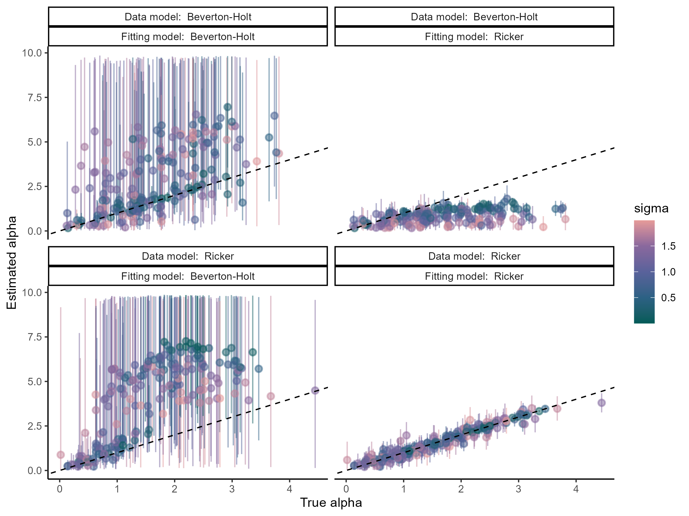

:::: {.columns}

<!-- style="display: flex; .align-items-start;"} -->

::: {.column width="55%"}

### Parameter Estimation and Identifiability Analysis for Ricker and Beverton-Holt models

We used simulations, profile likelihood, and Bayesian hierarchical modelling to check the limitations of commonly used fisheries models, such as the Ricker and the Beverton-Holt model.

Stay tuned for more.

:::

::: {.column width="5%"}
:::

::: {.column width="40%"}

{group="estimation"}
:::

::::

