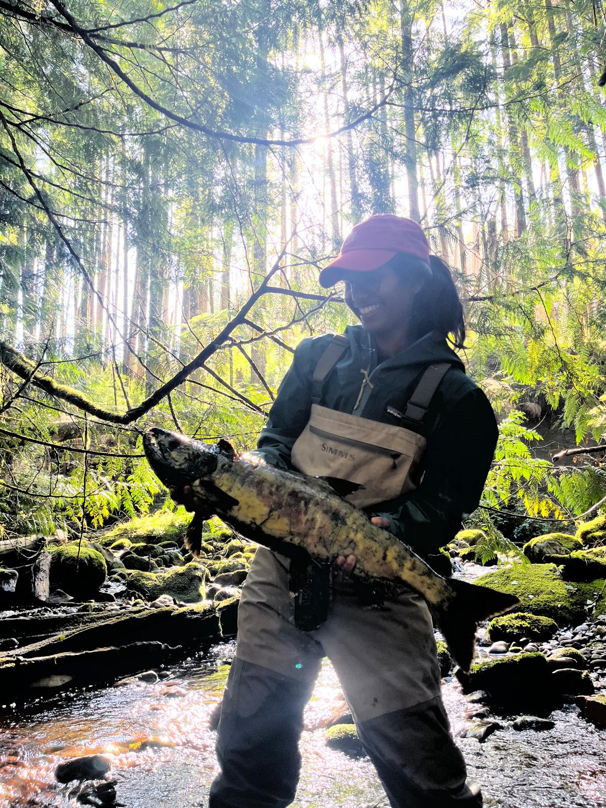

:::: {.columns}

<!-- style="display: flex; .align-items-start;"} -->

::: {.column width="55%"}
Changes in the structure and functioning of watersheds from forestry can affect the survival and growth of salmon during their freshwater life stages through various mechanisms.

We used a multi-stock hierarchical Bayesian model to assess the impact of historical clearcut logging in watersheds on salmon productivity across coastal BC as part of a collaborative project with Musgamagw Dzawada'enuxw Fisheries Group, Salmon Coast Society, University of Toronto, Trinity Consultants, Pacific Salmon Foundation, and Department of Fisheries and Ocean.

Stay tuned for results.

Hocking, M.D. & **Kuruvilla, M.**, et al. (2026). Cumulative effects of forest harvest on Pacific salmon productivity in coastal British Columbia. \[*In Review, Science*\]

:::

::: {.column width="5%"}
:::

::: {.column width="40%"}

{group="salmon"}

{group="salmon" style="display: none;" description="Chum salmon in Shoal River, August 2025. Image Credit - Leila Krichel."}
:::

::::