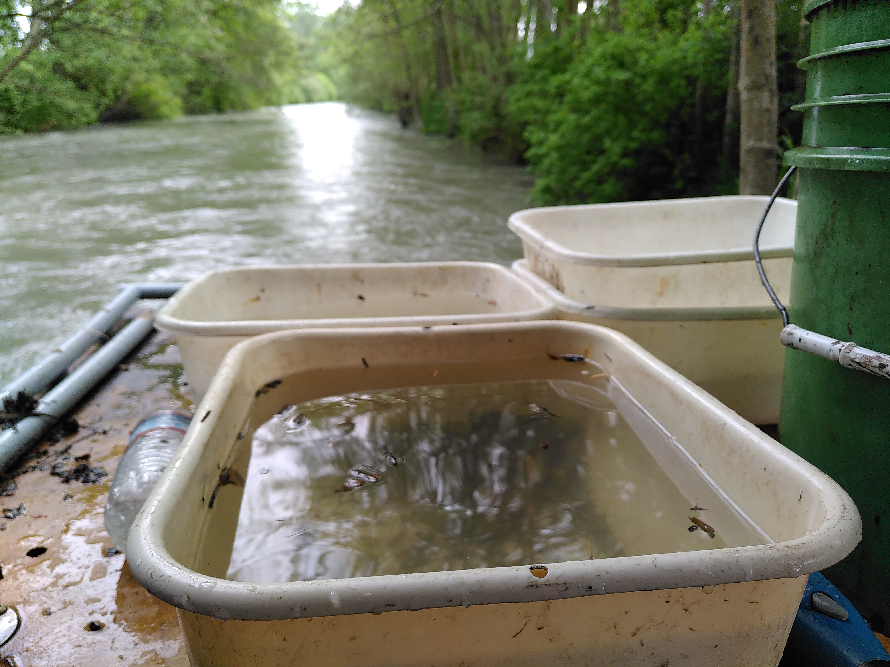

:::::: columns
::: {.column width="55%"}
### Project Overview

The large-scale seasonal migrations undertaken by many species require complex navigational and timing decisions. While the environmental factors influencing migration timing are well studied, the role of social interactions remains poorly understood.

In this project, we compiled 19 years of trap data from three rivers in Washington state to analyze the downstream seaward migration of juvenile Chinook and coho salmon.

### Key Findings

-   **Collective Decision Making:** An increase in hatchery salmon counts was a strong predictor for increased migration of wild salmon.
-   **Conservation Implications:** Incorporating social information allows animals to benefit from collective decision-making in noisy environments.

**Read the full paper:** [Movement Ecology (2026)](https://doi.org/10.1186/s40462-026-00644-y)
:::

::: {.column width="5%"}
:::

:::: {.column width="40%"}
::: lightbox
{group="migration" description="Juvenile salmon captured during hatchery release, May 2023. Image credit - Maria Kuruvilla."}

{group="migration" style="display: none;" description="Fish trap in the Dungeness River, May 2023. Image Credit - Maria Kuruvilla."}

:::
::::
::::::
